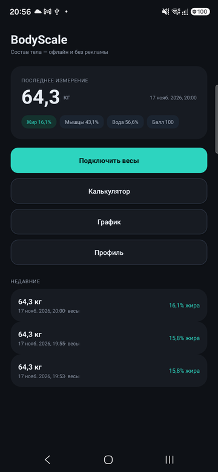
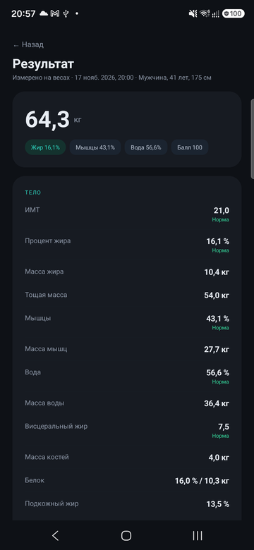
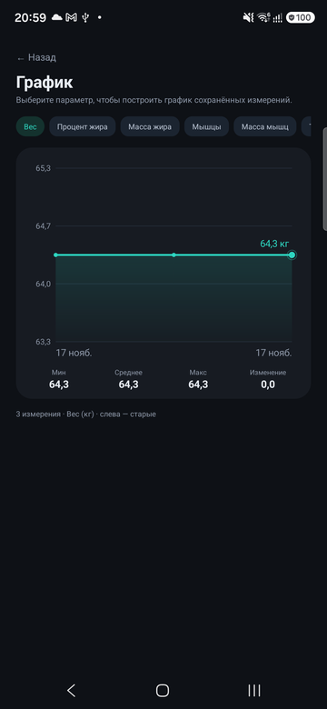

# BodyScale

**Ad-free, offline body-composition app for Chipsea / OKOK Bluetooth scales.**


BodyScale reads the weight and bio-impedance your scale broadcasts over BLE,
runs the BIA equations locally, and shows fat, muscle, water, visceral fat, BMR,
body age and more. It replaces the useful part of *OKOK international*
(`com.chipsea.btcontrol.en`) — without the five advertising SDKs, the account,
or the network access.

<p align="center">
  
  
  
</p>
<p align="center"><em>Russian UI, since the device locale is Russian — everything is also available in English.</em></p>

## Features

- **Automatic scale detection** — decodes Chipsea/OKOK manufacturer
  advertisements, so no account, cloud binding or MAC whitelist is needed.
- **Broadcast-only scales** — the tested scale is not connectable at all; weight
  and impedance arrive in the advertisement and are used directly.
- **GATT fallback** — connectable models are supported through the Chipsea
  `FFF0` service and the standard `0x181B` / `0x181D` services.
- **13 parameters** — weight, BMI, fat %, fat mass, muscle %, muscle mass, lean
  mass, water %, water mass, visceral fat, bone mass, protein, BMR, body age,
  body score, plus target/control values.
- **Calculator** — same equations from weight, height, age, sex and optional
  impedance, for when the scale is not at hand.
- **Chart** — plot any saved parameter with min / average / max / change.
- **History** — stored locally, deletable per reading.
- **English + Russian**, following the system language, with locale number
  formatting (`64,3 кг`).
- **No ads, no analytics, no `INTERNET` permission.**

## How it works

The original app does not list every BLE device. It inspects the
manufacturer-specific AD record (`AD type 0xFF`) and only accepts payloads that
start with `0xC0`, `0xCA` or `0xFF` (see `chipseaBroadcastFrame` in the vendor
APK). Those frames also contain the measurement itself:

```
C0 35 16 D0 17 70 0A 01 25 B4 56 5D 38 30 42
   │  └─┬─┘ └─┬─┘ └─┬─┘ │  └──── MAC ────┘
   │  weight  Z    product  flags (bit 0 = complete)
   └ sequence

weight = 0x16D0 / 100 = 58.40 kg
Z      = 0x1770 / 10  = 600.0 Ω
```

From weight, impedance, height, age and sex the app computes the composition
with the vendor's linear BIA fits, e.g. soft lean mass:

```
SLM = 0.2867·H + 0.3894·W − 0.0408·A − 0.01235·Z − 15.7665   (male)
```

and muscle mass as `SLM × 0.55` (skeletal-muscle share of soft lean mass).

The full protocol map, all coefficients, clamps and the GATT frame layouts are
documented in **[docs/analysis.md](docs/analysis.md)**.

## Privacy

| | |
|---|---|
| Internet permission | none |
| Analytics / crash reporting | none |
| Advertising | none |
| Storage | `SharedPreferences`, app-private |
| Permissions | `BLUETOOTH_SCAN`, `BLUETOOTH_CONNECT`; `ACCESS_FINE_LOCATION` on Android ≤ 11 only |

## Install

```bash
adb install -r app/build/outputs/apk/debug/app-debug.apk
```

Or build it yourself (see below). The debug APK is signed with the standard
debug key; use your own signing config for distribution.

## Build

Requirements: JDK 17+, Android SDK 36, build-tools 36.x.

```bash
export JAVA_HOME=/path/to/jdk-21
./gradlew assembleDebug     # or the Gradle 9.x distribution directly
```

The project intentionally has **no dependencies** beyond the Android framework —
no AndroidX, no Compose, no chart library. It builds offline once the SDK is
present.

## Project layout

```
app/src/main/java/uz/bodyscale/
├── algo/
│   ├── BodyMath.java           BIA equations, clamps, verdicts
│   ├── Metric.java             plottable parameters
│   └── Profile.java            sex / age / height / saved scale
├── ble/
│   ├── ScaleAdvertisement.java advertisement decoder (scale detection)
│   ├── ChipseaProtocol.java    GATT frames + outgoing instructions
│   └── BleScaleClient.java     scan / connect / notify
├── data/
│   ├── Measurement.java        one reading + JSON
│   └── HistoryStore.java       local history, delete
└── ui/                         home, scan, result, calculator, chart, profile
```

## Compatibility

| | |
|---|---|
| Tested phone | Samsung Galaxy A56 5G, Android 17 |
| Tested scale | Chipsea OUI `B4:56:5D`, broadcast-only, weight + impedance |
| Other Chipsea/OKOK scales | GATT path implemented, not hardware-tested |
| Encrypted v2 advertisements | detected and listed, values not decoded (key is server-issued) |
| 8-electrode / segmental scales | not supported (needs multi-electrode frames) |

Accuracy depends on the profile: without the correct height, age and sex the
equations drift, and a single reading is always less useful than a trend.

## Contributing

Issues and pull requests are welcome. If a scale does not work, the most useful
report contains the raw advertisement hex — the scan screen and logcat tag
`BodyScale` print it for every detected frame.

## Disclaimer

BodyScale is an independent, clean-room reimplementation for interoperability
with hardware you own. It is not affiliated with, endorsed by or derived from
source code of Chipsea Technologies or the OKOK app; no vendor binaries or code
are redistributed. Product names and trademarks belong to their owners.

**Not a medical device.** BIA estimates are not diagnoses; do not use them for
medical decisions.

## License

No license has been chosen for this repository yet. Add one (MIT or Apache-2.0
are typical for this kind of utility) before publishing.

---

### По-русски

Приложение для весов Chipsea/OKOK: читает вес и импеданс из BLE-рекламы,
считает состав тела локально (жир, мышцы, вода, висцеральный жир, BMR, возраст
тела и другое), строит графики и хранит историю. Без рекламы, без аккаунта,
без доступа в интернет. Интерфейс — русский и английский.
